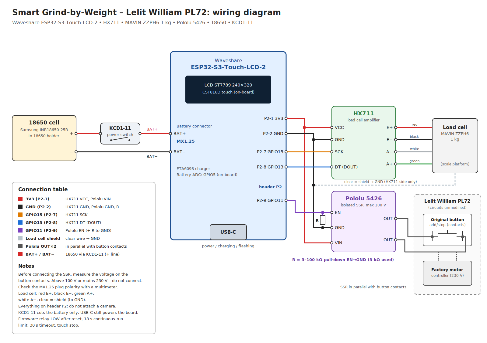

# Lelit William PL72 + Waveshare ESP32-S3-Touch-LCD-2

Port of the Smart Grind-by-Weight firmware to the **Waveshare ESP32-S3-Touch-LCD-2**
(ST7789 SPI 240×320 display, CST816D touch) for the **Lelit William PL72** grinder.
The grind-by-weight algorithm is unchanged from upstream. Everything board-specific is
behind `BOARD_WAVESHARE_ESP32S3_TOUCH_LCD_2`, so the upstream AMOLED build is unaffected.



## How it works

The PL72 grinds only while the add/stop button is held down (max. ~19 s per press).
A Pololu 5426 solid-state relay is wired **in parallel with the button contacts** and acts as a
"virtual finger": GPIO HIGH = grinding, GPIO LOW = stop. That matches the firmware's grinder
logic (output high = motor running). The factory motor controller, the original button and all
mains circuits stay untouched.

## Hardware

| Part | Notes |
|---|---|
| Waveshare ESP32-S3-Touch-LCD-2 | ESP32-S3R8 (8 MB octal PSRAM, 16 MB flash), ST7789 240×320, CST816D touch, ETA6098 Li-ion charger |
| HX711 module | Channel A, gain 128 (B+/B− not used) |
| MAVIN ZZPH6 1 kg load cell | 5 wires: red E+, black E−, green A+, white A−, clear = shield |
| Pololu 5426 SSR | Isolated, max. 100 V. The board has only a 20 kΩ series resistor on EN and **no pull-down** |
| 3 kΩ resistor | External pull-down EN → GND (anything from 3 kΩ to 100 kΩ works) |
| Samsung INR18650-25R + 18650 holder | Connected to the board's MX1.25 battery connector |
| KCD1-11 rocker switch | In the battery + line; cuts the battery only (USB-C still powers the board) |

## PlatformIO environments

| Environment | Purpose |
|---|---|
| `waveshare-esp32s3-touch-lcd-2` | Production firmware |
| `waveshare-esp32s3-touch-lcd-2-mock` | Simulated load cell, for testing display and touch without an HX711 |

```bash
pio run -e waveshare-esp32s3-touch-lcd-2 -t upload        # production firmware
pio run -e waveshare-esp32s3-touch-lcd-2-mock -t upload   # display/touch test
pio device monitor -b 115200
```

### Merged binary for browser flashing

```bash
B=.pio/build/waveshare-esp32s3-touch-lcd-2
esptool --chip esp32s3 merge-bin -o smart-grind-lcd2-pl72-merged.bin \
  --flash-mode keep --flash-freq keep --flash-size 16MB \
  0x0 $B/bootloader.bin 0x8000 $B/partitions.bin \
  0xe000 ~/.platformio/packages/framework-arduinoespressif32/tools/partitions/boot_app0.bin \
  0x20000 $B/firmware.bin
```

Flash it with [ESP Tool (esptool-js)](https://espressif.github.io/esptool-js/) in Chrome/Edge:
address `0x0`, use **Erase Flash** first. If the board does not connect, hold BOOT while plugging in USB.

## Pins (`src/config/hardware.h`)

| Function | GPIO | Notes |
|---|---|---|
| LCD MOSI / SCLK / CS / DC / MISO | 38 / 39 / 45 / 42 / 40 | per Waveshare demo |
| LCD backlight | 1 | PWM (brightness in the menu) |
| Touch SDA / SCL | 48 / 47 | CST816D, address 0x15, bus shared with the IMU |
| HX711 SCK | 15 | header P2, pin 7 |
| HX711 DOUT | 13 | header P2, pin 8 |
| SSR (Pololu 5426 EN) | 11 | header P2, pin 9 |
| 3V3 / GND | – | header P2, pins 1 / 2 (second GND: pin 13) |
| Battery ADC | 5 | on-board 200k/100k divider (×3) |
| Charge detect (CHG_DET) | 18 | on-board, HIGH while the ETA6098 is charging (Q2 inverts STAT, 10k pull-up) |

**All external signals are on header P2** (Waveshare schematic
[ESP32-S3-Touch-LCD-2_V2](https://files.waveshare.com/wiki/ESP32-S3-Touch-LCD-2/ESP32-S3-Touch-LCD-2_V2.pdf)).
P2 pinout: 1 3V3, 2 GND, 3 IO43, 4 IO44, 5 IO47, 6 IO48, 7 IO15, 8 IO13, 9 IO11, 10 IO12, 11 IO14, 12 IO9,
13 GND, 14 VBAT. GPIO 15/13/11 are camera lines, so **do not attach a camera**. If you pick other pins,
change them in `hardware.h` and avoid the strapping pins 0, 3, 45, 46 and UART0 (43/44).
Free pins for future use: IO12, IO14, IO9.

## Wiring

- **HX711:** VCC → 3V3, GND → GND, DT → GPIO13, SCK → GPIO15. MAVIN load cell: E+ red, E− black,
  A+ green, A− white. The clear wire is the cable shield: connect it to GND **on the HX711 side only**
  (leave it unconnected at the load cell). B+/B− stay unconnected.
- **Pololu 5426:** VIN → 3V3, GND → GND, EN → GPIO11, plus a **3 kΩ pull-down EN → GND** that keeps
  the relay off during reset and boot. The two output pins go in parallel with the add/stop button contacts.
- **Power:** 18650 → KCD1-11 → MX1.25 battery connector on the board (charging over USB-C via the ETA6098,
  ~0.5 A set by R15 = 360 kΩ, so a full 2500 mAh charge takes ~5 h). **Check the connector polarity with
  a multimeter.**

## Safety

1. `setup()` drives the relay output LOW as its very first action, and `Grinder::init()` also enables the internal pull-down.
2. The external pull-down on EN keeps the relay off during the boot ROM phase.
3. `HW_GRINDER_MAX_CONTINUOUS_ON_MS = 18000`: an independent `esp_timer` in the grinder driver forces the output LOW after 18 s of continuous on-time (below the PL72's 19 s limit).
4. `GRIND_TIMEOUT_SEC = 30`: limit for a whole grind session (upstream mechanism).
5. Touch stop at any time. Any ESP failure (reset, power loss, KCD1 off) releases the "virtual button", so the grinder stops.

## UI changes for the 240×320 display

- `src/config/ui_layout.h` scales the upstream 280×456 layout: `UI_SX()` / `UI_SY()` for horizontal/vertical sizes, a font map, and board-specific values (arc diameter, chart height, menu title font, autotune console size, calibration screen positions).
- `UI_TOP_INSET_PX = 22` reserves a top strip for the status bar; `UI_CONTENT_TOP_PX` is used by the arc, chart and OTA screens.

### Status bar

- Shown on every screen: live weight on the left; battery, warning and Bluetooth icons on the right.
- The weight refreshes every 150 ms and is shown continuously; it is hidden only when the scale is not calibrated.

### Battery indicator (`src/hardware/battery_monitor.{h,cpp}`)

- Voltage from GPIO5: 16 ADC samples, min/max dropped, ×3 divider, optional `HW_BATTERY_VOLTAGE_CAL`, then an EMA filter. The filter restarts when the charger is plugged in or unplugged.
- Percentage from a Li-ion (INR18650-25R) voltage curve, with hysteresis: while charging it only rises, on battery it only falls (2 % step).
- Charging (CHG_DET high) shows a lightning icon. While charging the cell's terminal voltage reads ~0.1–0.2 V high, so the percentage drops a bit after unplugging; that is expected.
- **USB only (battery switched off):** the board has no VBUS sense line (USB 5 V only feeds the charger, D1 and the Q1 power-path MOSFET), so this state is detected from how the charger behaves without a cell: CHG_DET toggling ≥3 times in 12 s, VBAT > 4.25 V, or VBAT swinging > 0.12 V while CHG is steady. The status bar then shows "USB" instead of a percentage.
- **Calibration:** Menu → System Info shows `Battery:` (filtered voltage, %, CHG / "USB only") and `Batt ADC:` (raw voltage, spread `d`, CHG toggles `t`). Compare with a multimeter on the cell; if they differ, set `HW_BATTERY_VOLTAGE_CAL` in `hardware.h` to (multimeter voltage / displayed voltage).

### Boot auto-tare

About 2.5 s after power-on the scale is tared once, in the background (non-blocking tare in the sampling task, no overlay); the UI stays usable. It gives up after 20 s if the sensor is not ready. Tare before grinding and in the Scale menu is unchanged.

### Swipe gestures (Grind Settings)

- **Mode:** vertical swipe toggles Weight/Time (upstream behaviour).
- **Profile:** vertical swipe switches Single/Double/Custom (up = next, down = previous). In this mode the ready screen has two horizontal pages, [profiles] and [MAIN MENU]; the three profiles are stacked on the first page and slide vertically with a fade animation.
- The two options are mutually exclusive. Settings live in Preferences namespace `swipe`, keys `enabled` (Mode) and `profiles` (Profile).

### System Info additions

`Battery`, `Batt ADC` and `Last reset` (reason for the last restart: POWER ON, SOFTWARE, PANIC, TASK WDT, INT WDT, BROWNOUT…), which helps diagnose freezes.

## Memory: LVGL in PSRAM

The Arduino heap places every allocation < 4 KB in internal RAM, so LVGL objects used ~140 KB of
internal RAM. After BLE started there was no room left for FreeRTOS task stacks (boot halted with the
backlight on and a blank screen) or for allocations during rendering (freeze, then watchdog reset).
LVGL now uses a custom allocator that puts its data in PSRAM (`src/ui/lv_mem_psram.cpp`,
`LV_STDLIB_CUSTOM` in `include/lv_conf.h`, only when `BOARD_HAS_PSRAM` is set). In a QEMU test
(without BLE), free internal heap went from 75 KB to 214 KB. The UI task stack is 12 KB
(`SYS_TASK_UI_STACK_SIZE`). The startup log prints `Internal heap free` right before tasks are created.

## Development notes

- Top-ups use relay pulses of 50–300 ms; the minimum pulse time is in `src/config/grind_control.h` if the PL72 ever misses short pulses.
- Branch history: port (`4aa8307`), UI scaling, wiring docs, pins on P2, status bar/battery/gestures, bug fixes, PSRAM allocator.
- The wiring diagram is generated by `tools/docs/gen_wiring_diagram.py` (run from the repo root, needs `cairosvg`).
- Emulation: Espressif QEMU (`qemu-system-xtensa -machine esp32s3 -m 8M -global driver=ssi_psram,property=is_octal,value=true`) can boot this firmware if BLE is skipped, `ARDUINO_USB_CDC_ON_BOOT=0` is set so logs go to UART0, and the startup ADC self-calibration (`adc_hw_calibration`) is patched to return immediately (QEMU has no ADC). It is useful for memory and boot-order checks, not for UI.

## To do

- Low-battery cutoff (GPIO5, ~3.3 V).
- Optional reliable USB detection: 100 kΩ / 100 kΩ divider from the 5V pin on header P1 to a free GPIO (e.g. IO12, P2-10), giving ~2.5 V with USB present and 0 V on battery.
